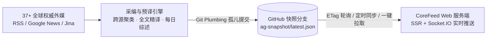

<div align="center">
  

  # CoreFeed · 聚核

  **全球权威外媒要闻聚合、跨源印证与中文深度阅读平台**

  [](https://nodejs.org/)
  [](Dockerfile)
  [](LICENSE)
</div>

---

**CoreFeed** 面向高信噪比国际资讯阅读场景，自动巡检全球 **37+ 家主流权威媒体**（Reuters、AP、BBC、FT、WSJ、Bloomberg、NYT、The Economist、NHK、SCMP 等），在采编阶段一次性完成**跨信源同事件归并、核心要点提炼、原文全文中文精译与每日深度综述**，并通过 GitHub 快照分支实现免公网 IP、零 API Key 依赖的轻量自托管阅读体验。

## 核心特性

- **全球信源与交叉印证**：内置 37+ 家国际通讯社、财经与科技权威媒体矩阵，支持同事件多媒归并展示与防盗链题图代理。
- **预译全文与每日综述**：采编阶段直接预生成中文标题、导读提要、核心要点、分段全文中文译文及《今日全球要闻深度综述》，点击卡片即可离线秒开阅读。
- **零密钥轻量同步架构**：精编快照通过 Git Plumbing 发布至独立 `ag-snapshot` 分支；自托管服务端无需配置任何大模型 API Key 或暴露公网端口，支持每日定时拉取与一键同步。
- **瑞士纸媒级阅读界面**：采用宣纸暖白与曜石墨黑高对比纸媒排版，Top-3 重点要闻轮播搭配三栏精炼卡片、多维筛选与深浅色主题切换。

## 架构概览



## 快速开始

### 1. 本地运行

```bash
git clone https://github.com/alanhsun/CoreFeed.git
cd CoreFeed
npm run setup
npm start
```

启动后访问 `http://localhost:3120`（Windows 环境可直接双击运行 `start-local.bat`）。

### 2. Docker Compose 部署

```bash
cp .env.example .env
docker-compose up -d
```

### 3. Linux / Docker 远程一键部署与热更新

在任意终端通过 SSH 一键完成远程服务端部署（将 `<YOUR_SERVER_IP>` 替换为目标服务器地址）：

```bash
ssh root@<YOUR_SERVER_IP> "wget -qO /tmp/deploy-router.sh https://raw.githubusercontent.com/alanhsun/CoreFeed/main/deploy-router.sh && sh /tmp/deploy-router.sh --rebuild && rm -f /tmp/deploy-router.sh"
```

首次部署后，日常代码热更新仅需执行：

```bash
ssh root@<YOUR_SERVER_IP> "sh /opt/corefeed/deploy-router.sh"
```

## 常用命令

| 命令 | 说明 |
| :--- | :--- |
| `npm start` | 启动 CoreFeed Web 阅读服务端（默认端口 `3120`） |
| `npm run ag:auto` | 执行全自动全球信源采集、全文中文编译并发布至 `ag-snapshot` 快照分支 |
| `npm run ag:daemon` | 启动采编常驻守护进程（默认每日 `07:40 / 12:10 / 19:10` 自动预采编推送） |
| `npm run ag:schedule` | 注册操作系统级（Windows 计划任务 / Linux Crontab / macOS Launchd）定时采编 |
| `npm test` | 运行全量自动化回归测试套件 |

## 核心配置 (`.env`)

完整配置项参见 [`.env.example`](.env.example)，常用参数如下：

| 变量名 | 默认值 | 说明 |
| :--- | :--- | :--- |
| `PORT` | `3120` | Web 服务监听端口 |
| `GITHUB_SYNC_ENABLED` | `true` | 是否自动从 GitHub `ag-snapshot` 分支同步最新精编快照 |
| `GITHUB_SNAPSHOT_URL` | `https://raw.githubusercontent.com/alanhsun/CoreFeed/ag-snapshot/latest.json` | 远程精编快照 Raw 地址 |
| `UPDATE_TIMES` | `08:00,12:30,19:30` | 服务端每日自动同步时间点（`Asia/Shanghai`） |
| `PUBLISH_SECRET` | 空 | 跨节点直推 `/api/agent/publish` 接口鉴权密钥（可选） |
| `AI_API_KEY` | 空 | OpenAI 兼容大模型密钥（可选；留空即使用内置免密钥翻译与综述引擎） |

## 目录结构

```text
CoreFeed/
├── config/                 # 全局动态配置与 37+ 国际权威信源矩阵
├── middleware/             # 全局异常处理与生产环境速率限制
├── public/                 # 品牌图标、Swiss Editorial 样式表与前端交互控制器
├── routes/                 # RESTful API、快照同步与外媒图片防盗链代理
├── scripts/                # 信源采集、快照发布与跨平台定时任务脚本
├── services/               # 多阶段采集巡检、事件聚类、中文预译与状态管理
├── tests/                  # 采编同步流水线与部署脚本自动化测试
├── utils/                  # GitHub Plumbing 快照同步器、定时调度与通用工具
├── views/                  # EJS 服务端首屏渲染模板
└── server.js               # Express + Socket.IO 应用主入口
```

## License

Released under the [MIT License](package.json).
